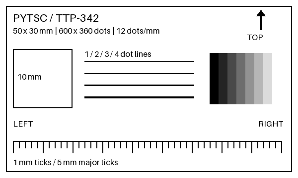

# pytsc

Experimental Python library and CLI for TSC/TSPL label printers, with an API and
Click CLI modeled after [brother_ql](https://github.com/pklaus/brother_ql).
The initial target is **elitek TTP-342 through an RS-232/USB adapter**, using
**pyserial**. [pyniim](https://github.com/buganini/pyniim) also informs the convenience
API and honest transmission-result reporting.

**Status: 0.1.0a1; no physical printer verification yet.** TTP-342 is a provisional
300 dpi / 12 dots per mm, 104 mm maximum-width profile based on TSC documentation.
The elitek-branded device's firmware, serial settings and bitmap compatibility
must still be checked. Serial and CUPS backends are implemented. Direct pyusb/network transports,
status polling, cutting and automatic calibration are not implemented.
USB printing through an installed CUPS queue is supported.

## Install

Python 3.11+; install this checkout (not a published PyPI release):

```sh
python3 -m venv .venv
source .venv/bin/activate
python -m pip install -e .
pytsc --help
pytsc discover
```

Dependencies: Pillow for raster conversion, Click for CLI, pyserial for RS-232.
No Windows DLL or .NET runtime is needed. Serial discovery lists ports and adapter
metadata; it cannot identify the printer behind an adapter. No port is opened by
discovery, conversion or preview commands.

## 實機測試：直接印附帶圖片



`examples/test-label.png` 是 **50 × 30 mm、600 × 360 px** 的測試圖，含方向標記、
10 mm 方框、1–4 dot 細線、灰階與 1 mm 刻度。不需要 Python example 檔。
先確認裝入的標籤尺寸、間隙，以及印表機的 serial 設定；以下 9600、8N1、
無流量控制只是可調整的起點，不代表已確認的原廠設定。

```sh
# 找到 adapter 的裝置路徑；macOS 通常為 /dev/cu.usbserial-...
pytsc discover --json

# 不連線：預覽及輸出 TSPL
pytsc -m TTP-342 preview -l 50x30 examples/test-label.png -o /tmp/preview.png
pytsc -m TTP-342 convert -l 50x30 --gap 2 examples/test-label.png -o /tmp/test.tspl
pytsc analyze /tmp/test.tspl --output-dir /tmp/pytsc-bitmaps

# 把路徑、baud rate 與 gap 換成實際設定；印一張
pytsc -b serial -m TTP-342 -p /dev/cu.usbserial-YOUR_ADAPTER --baudrate 9600 \
  print -l 50x30 --gap 2 --copies 1 examples/test-label.png

# 或送出剛才的指令檔（會再印一張）
pytsc -p /dev/cu.usbserial-YOUR_ADAPTER --baudrate 9600 send /tmp/test.tspl
```

Windows 使用 `-p COM3`；Linux 使用 `-p /dev/ttyUSB0`，或使用穩定的
`/dev/serial/by-id/...` 路徑。也接受 `serial:///dev/cu.usbserial-...`。
macOS 若沒有列出 adapter，先檢查轉接器是否插入、驅動與線材；不要選 Bluetooth
或 debug-console 埠。

其他尺寸可明確縮放，例如 `print -l 40x30 --fit contain ...`，但圖上的 10 mm
與刻度也會跟著縮小，不能再用來校正尺寸。預設 `--fit strict` 拒絕不合尺寸的圖。
`--rotate auto` 僅處理寬高剛好對調的情況。300 dpi profile 使用印字頭實際的
12 dots/mm，因此 50 mm 是 600 dots，不是用 300/25.4 換算。

## CLI

Global options precede the command, as in brother_ql:

- `-b/--backend serial|cups`, `-m/--model`, `-p/--printer`, `--debug`, `--version`.
- `--baudrate`, `--parity N|E|O`, `--stopbits 1|2` (8 data bits).
- `--flow-control none|rtscts|dsrdtr`; this must match the printer and cable.
- `--timeout 120`: whole-job transmission deadline, in seconds.

Commands: `discover`, `info models|labels|env`, `print`, `send`, `analyze`.
`convert` and `preview` are offline extensions. `print`, `send`, `discover`, `info`
and `analyze` support `--json`. Debug messages go to stderr.

Image commands accept `-l/--label WIDTHxHEIGHT`, `-r/--rotate`, `-t/--threshold`,
`-d/--dither`, `--fit`, `--gap`, `--media gap|black-mark|continuous`, `--density`,
`--direction`, `--speed` and `--copies`. Threshold is a percentage, default 70;
lower values produce more black, following brother_ql. Speed is omitted unless
requested, retaining the printer's current speed. Direction defaults to 1 and
must be verified physically. Preview shows the input raster, not media feeding
or firmware orientation. `analyze` extracts individual BITMAPs, not composited
native text/barcodes or a full emulation of TSPL.

Environment variables: `PYTSC_BACKEND`, `PYTSC_MODEL`, `PYTSC_PRINTER`,
`PYTSC_BAUDRATE`, `PYTSC_LABEL`.

## Python API

```python
from pytsc import Printer

with Printer("/dev/cu.usbserial-YOUR_ADAPTER", model="TTP-342", baudrate=9600) as printer:
    result = printer.print_image("examples/test-label.png", label="50x30", gap=2)
```

The brother_ql-style split API keeps conversion independent of communication:

```python
from pytsc.raster import TSPLRaster
from pytsc.conversion import convert
from pytsc.backends.helpers import discover, send

raster = TSPLRaster("TTP-342")
instructions = convert(raster, images=["examples/test-label.png"], label="50x30")
# instructions is raw bytes, suitable for saving as a .tspl file.
result = send(instructions, printer_identifier="/dev/cu.usbserial-YOUR_ADAPTER",
              backend_identifier="serial", baudrate=9600)
```

`convert()` accepts paths, Pillow images, or binary file objects readable by
Pillow. It composites transparency onto white, optionally rotates/resizes,
converts to monochrome, then emits `SIZE`, media settings, `CLS`, `BITMAP` and
`PRINT`. Multiple inputs produce sequential labels; multi-frame image files
only use the selected/first frame. Existing `raster.data` is replaced only after
successful conversion. SVG/PDF/text layout must be rasterized first.

Native commands are also available through the chainable builder:

```python
job = (TSPLRaster("TTP-342").setup("50x30", gap=2).clear()
       .text(24, 24, "Hello TSPL")
       .barcode(24, 80, "12345678", height=80)
       .print_label(copies=1))
# Send job.data with the same send() function.
```

Native text accepts printable ASCII without quotes/backslashes; for Chinese or
custom fonts, render to an image. `command()` is an explicit low-level escape hatch
for a single ASCII command. Caller-supplied raw TSPL files are sent unchanged.
This is API design compatibility, not a drop-in replacement for Brother's binary
protocol, model names or fixed label catalog.

## Serial transport and results

Bitmap bytes may contain XON/XOFF control bytes. Software flow control is therefore
not exposed; use a correctly wired hardware handshake when supported. No automatic
job retry occurs after errors, to avoid duplicate labels or completing a partial
command with the wrong bytes. A failed `Printer` session must be closed and reopened.

A successful result contains `instructions_sent=True`, `outcome="sent"`,
`bytes_sent`, `did_print=False`, `ready_for_next_job=False`, `printer_state=None`.
Here `False` means **not confirmed**, not proof that nothing printed. This release
waits for writes and the host's output queue to drain; that does not prove that
an adapter or printer received the data, or that a physical label printed.
`blocking=False` is not implemented. No completion/status query is claimed.

`PrintError.result` retains known progress. Its `outcome="unknown"` means a partial
job may have reached the device. `bytes_sent` counts acknowledged host write calls;
a failed write can have transmitted additional bytes before raising. JSON-mode
runtime failures exit 1; argument errors use Click stderr and exit 2.

A 600 × 360 bitmap is 27,000 bytes, taking at least about 28 seconds over 9600 baud
8N1, plus commands. Increase `--timeout` for larger jobs. If output is blank,
garbled or truncated, verify baud/parity/stop bits, RS-232 cable wiring and hardware
flow control, label/ribbon setup and TSPL mode before resending. Record measured
results in [docs/HARDWARE_TESTING.md](docs/HARDWARE_TESTING.md).

## Development

```sh
python -m pip install -e '.[dev]'
pytest -q
ruff check src tests
ruff format --check src tests
python -m build
```

Tests use synthetic images and fake serial ports; they never print a label.

## References

- [brother_ql](https://github.com/pklaus/brother_ql): API/CLI design reference; no implementation code copied.
- [pyniim](https://github.com/buganini/pyniim): convenience API and result conventions; local checkout reviewed.
- [tsclib](https://pypi.org/project/tsclib/): native TSPL operations reference; this project does not wrap its Windows DLL.
- [TSC downloads](https://usca.tscprinters.com/en/downloads): TSPL/TSPL2 programming manuals.
- [TSC TSPL/TSPL2 manual, mirrored PDF](https://manuals.plus/m/f21e1cc8c532dfa7d3838ac4677bfd4b438f37282bd5460b0292b179a72fdec7_optim.pdf): BITMAP width in bytes, height in dots and mode 0 overwrite.
- [TSC TTP-243/342 specification sheet, mirrored PDF](https://autoid.com.hk/pos/labelprinter/tsc/ttp-243.pdf): TTP-342 12 dots/mm profile basis; does not establish elitek firmware compatibility.
- [pyserial API](https://pyserial.readthedocs.io/en/latest/pyserial_api.html): serial parameters and transport behavior.

## macOS / Linux：CUPS USB 列印

USB-to-IEEE-1284 adapters are CUPS printer devices, not serial ports. Use the
`cups` backend on macOS or Linux with CUPS client tools (`lp`, `lpstat`, `lpinfo`).
Windows print queues are not supported. No Python CUPS extension is required.

```sh
pytsc -b cups discover --json
```

Discovery lists configured queues (`cups://QUEUE`, `kind=queue`, `printable=true`)
and unconfigured device URIs (`kind=device`, `printable=false`). `printable` means
a queue exists, not that the printer is online/accepting jobs or TSPL-compatible.
If device discovery requires privileges, is unavailable or times out, queue results
remain visible with a warning record. Discovery never creates a queue or prints.

For the reported device `usb://Unknown/IEEE-1284%20Controller?location=1140000`,
you can print directly (queue setup is automatic when permitted):

```sh
pytsc -b cups -p 'usb://Unknown/IEEE-1284%20Controller?location=1140000' \
  print -l 50x30 --gap 2 examples/test-label.png
```

Alternatively, manually create a queue on CUPS versions supporting raw queues:

```sh
sudo lpadmin -p TTP342 -E -v 'usb://Unknown/IEEE-1284%20Controller?location=1140000' -m raw
pytsc -b cups -m TTP-342 -p TTP342 print -l 50x30 --gap 2 examples/test-label.png
# Equivalently: -p cups://TTP342
```

When passing a USB URI to print/send, pytsc reuses an exactly matching queue or
creates a persistent queue named `pytsc_<URI hash>` and verifies its device URI.
On macOS it uses the system Generic PostScript PPD (`lpadmin -P`), because macOS
rejects `-m raw`. TSPL jobs still use `lp -o raw` to bypass PPD rendering; this does
not make the printer PostScript-compatible. Do not use the generic queue for normal
macOS document printing. Linux currently uses `-m raw`.
It never invokes sudo automatically. Permission errors include the exact setup
command; unsupported raw queues require system printer configuration.
Raw queues are deprecated in newer CUPS; if your version rejects them, configure
a suitable queue using system printer settings and verify it accepts raw TSPL.
The device URI can change when moving USB ports. `-p` accepts a queue name, `cups://QUEUE`, or an encoded `usb://` URI. Baud rate and serial handshaking do not apply to CUPS.

Submission uses `lp -d QUEUE -n 1 -o raw -o job-sheets=none,none -- -`, passing
TSPL bytes on stdin without shell interpretation or document conversion. Copies
are encoded in TSPL, so CUPS is always asked to spool one copy. Results report
`outcome="queued"` and `job_id` when available; queue acceptance does not confirm
printer receipt or physical printing. On a submission timeout/failure, inspect
`lpstat -o QUEUE` before retrying. `--timeout` limits submission, not printing.

Python: `Printer("TTP342", backend="cups")`, or
`send(data, "TTP342", backend_identifier="cups")`. Serial-specific keyword
arguments are not accepted by the CUPS API.

`pytsc discover` and Python `discover()` scan both serial and CUPS by default.
Each record includes its `backend`; failures of one backend appear as warnings
without discarding results from the other. Explicit `-b` or `PYTSC_BACKEND` restricts
the CLI scan. Printing automatically selects CUPS for `usb://` and `cups://` identifiers,
and serial otherwise. Bare CUPS queue names require `-b cups`. Explicit `-b` or
`PYTSC_BACKEND` takes precedence over inference. Python `Printer` and `send()`
use the same inference when no backend is provided.
Discovery never creates queues. USB queue resolution/creation happens only when
sending a nonempty job; no print job is submitted if setup or verification fails.
